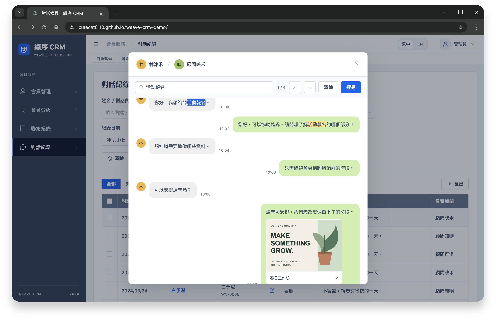
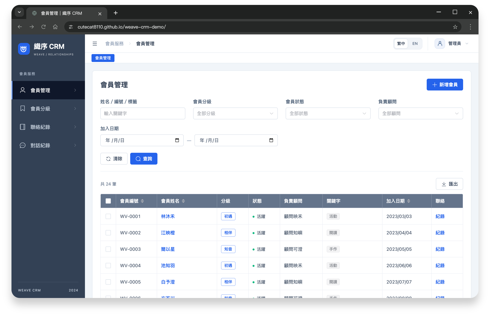
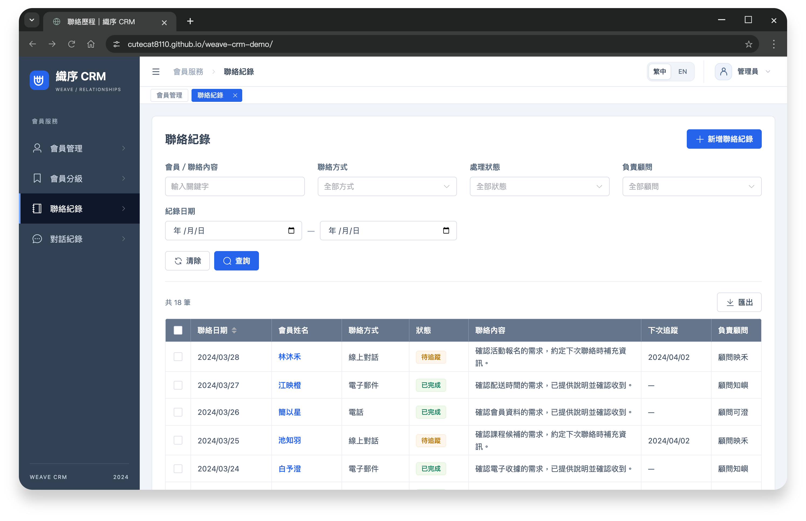

# 織序 CRM｜會員管理與對話搜尋展示

    

整合會員分級、聯絡歷程與多管道對話，支援關鍵字定位、圖片預覽及中英切換。

[**開啟 Demo →**](https://cutecat8110.github.io/weave-crm-demo/#/login)

| 功能入口 | 可以體驗 |
| --- | --- |
| [對話紀錄](https://cutecat8110.github.io/weave-crm-demo/#/conversations) | 訊息／客服／簡訊分類、命中高亮、逐筆定位、圖片放大 |
| [會員管理](https://cutecat8110.github.io/weave-crm-demo/#/members) | 多條件查詢、編輯、福利資格與依角色區分資料範圍 |
| [會員分級](https://cutecat8110.github.io/weave-crm-demo/#/tiers) | 福利設定、啟用／停用、會員關聯與刪除檢查 |
| [聯絡紀錄](https://cutecat8110.github.io/weave-crm-demo/#/contacts) | 帶入會員、新增紀錄、安排追蹤及回看歷程 |

**建議體驗**

1. 帶入管理員帳密，在對話紀錄開啟「林沐禾」，搜尋「活動報名」，切換命中並開啟圖片。
2. 編輯「初遇」分級的福利，再查看會員的可用項目；暫停會員或停用分級，資格會同步改變。
3. 切換右上角 **EN**，查看英文表單、驗證、日期及匯出。
4. 登出後帶入顧問，對照負責會員的資料範圍。

管理員可管理全部資料；顧問僅處理負責會員及相關紀錄；唯讀可查詢及匯出。

會員管理與聯絡歷程

實作重點

- 共用列表、編輯器與語系字典，統一查詢、驗證、分頁與操作回饋。
- 搜尋保留前後對話；圖片按需載入，預覽支援縮放、鍵盤及失敗重試。
- 會員範圍統一套用於列表、關聯選取、歷程及 CSV；福利依會員與分級狀態判定。
- IndexedDB 交易、版本檢查與資料升版，保留修改並避免跨分頁覆蓋；儲存失敗保留草稿。

資料與使用範圍

使用虛構品牌、人物與對話，圖片為展示素材。角色與福利在瀏覽器內模擬，不提供伺服器身分驗證或訊息發送功能。

修改保存在目前瀏覽器；登入、語言與查詢條件依分頁保存。中英切換不翻譯會員姓名、筆記或對話原文。此展示使用 Nuxt 4。

「重設資料」會恢復初始內容、清除本作品各分頁的修改與草稿，並登出所有分頁；其他作品不受影響。清除瀏覽器資料也會移除修改。

